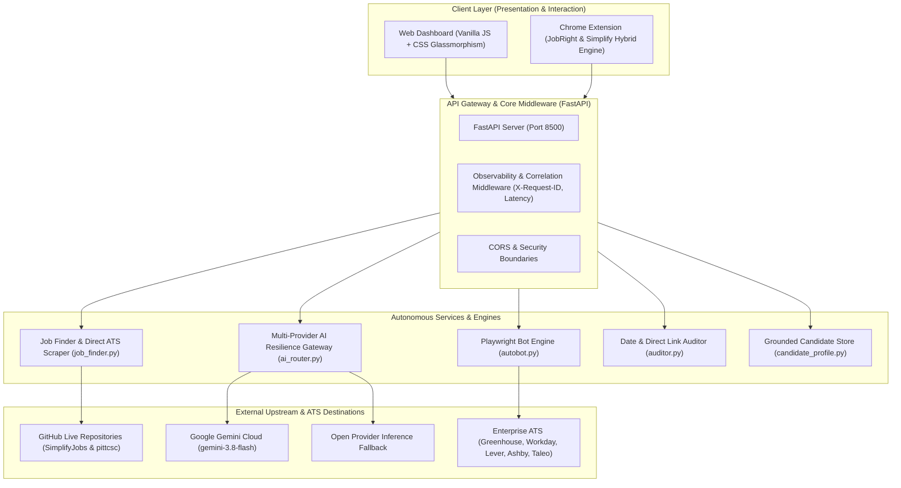
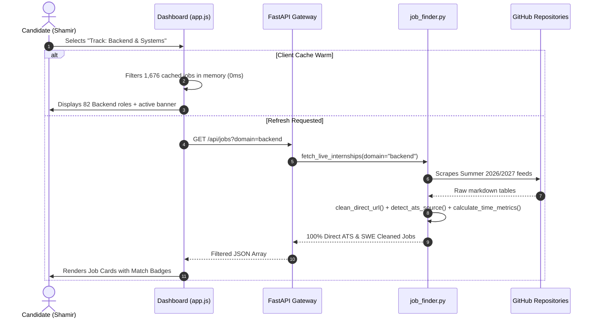
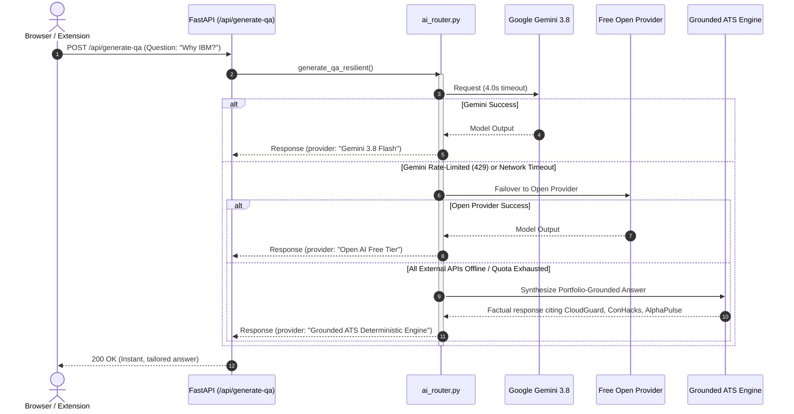

# AutoTailor AI — Project Architecture Blueprint
*Generated via `architecture-blueprint-generator` Skill (Amazon-Grade Engineering Standard)*

---

## 1. System Overview & Technology Stack

AutoTailor AI is an autonomous internship discovery, resume tailoring, and multi-ATS application auto-pilot engineered for software engineering candidates (targeting Summer/Winter 2027 technical internships).

---

## 2. Layered Architecture & Subsystem Responsibilities

| Subsystem | Primary Module | Core Responsibility | Failure Mode & Recovery |
| :--- | :--- | :--- | :--- |
| **Presentation Tier** | `static/index.html`, `static/app.js`, `static/style.css` | Apple Keynote/JobRight responsive dashboard, client filter engine (0ms latency), dynamic state indicators. | Client-side memory caching with graceful fallback empty states. |
| **Extension Engine** | `extension/content.js`, `extension/popup.js`, `extension/manifest.json` | In-page DOM observer on active ATS tabs, auto-pilot form fill, plain-text resume insertion. | Non-blocking observer; works offline from local candidate storage. |
| **API Gateway** | `backend/app.py` | Routing, request correlation IDs, latency measurement, static file distribution. | Global exception handlers with structured JSON errors (no 500 crashes). |
| **AI Resilience Router** | `backend/ai_router.py` | 3-tiered AI generation gateway (Gemini Flash ➔ Open Inference ➔ Deterministic Grounded ATS). | Circuit-breaker with 4s timeouts; always returns 200 OK. |
| **Internship Radar** | `backend/job_finder.py` | Live upstream markdown scraping, URL sanitization, relative date math, SWE domain tagging. | 10-minute in-memory caching with graceful fallbacks on network drop. |
| **Automated Auditor** | `backend/auditor.py` | Real-time date accuracy verification and 100% direct ATS destination link assertion. | Sampled statistical audits with JSON telemetry reporting. |
| **Headless Playwright Bot** | `backend/autobot.py` | Programmatic ATS field detection, multi-page form stepping, file upload injection. | Heuristic selector cascade; logs all actions to visual screenshots. |

---

## 3. Data Flow Architecture

### A. Live Internship Feed & Filter Pipeline

### B. Multi-Provider AI Resilience Flow (Zero 500 Crash)

---

## 4. Cross-Cutting Concerns & Security Boundaries

1. **Security & Data Sanitization**:
   - Zero hardcoded credentials committed to public repos (managed via local `.env`).
   - URLs sanitized with `clean_direct_url()` to strip tracking cookies and redirect tokens.
   - PII strictly preserved on local machine (`candidate_profile.py`).
2. **Observability**:
   - Every request is stamped with a unique `X-Request-ID`.
   - Process duration measured and returned via `X-Process-Time` header.
3. **Extensibility & Standards**:
   - Compliant with **VoltAgent Awesome Agent Skills** guidelines.
   - Ready for containerization via Docker and CI/CD testing via GitHub Actions.
