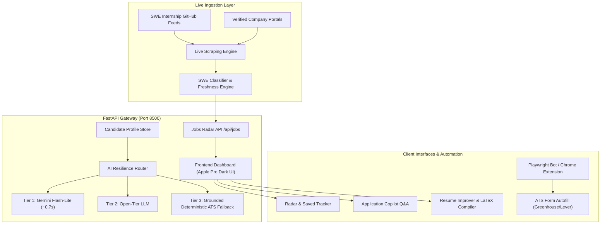

# AutoTailor AI ⚡
### Autonomous SWE Internship Radar, Multi-Tier Application Copilot & ATS Resume Optimizer

[](https://www.python.org/)
[](https://fastapi.tiangolo.com/)
[-8E75B2.svg?logo=googlegemini&logoColor=white)](https://ai.google.dev/)
[](https://playwright.dev/)
[](LICENSE)
[](tests/)

---

## 🌟 Overview

**AutoTailor AI** is an end-to-end, full-stack autonomous career engineering platform. It pairs a live, high-frequency software engineering internship radar with a multi-tier AI resilience gateway to discover roles, solve application questionnaires in real-time, generate authentic cover letters, improve and tailor 1-page ATS LaTeX resumes, and autofill multi-step job applications across standard ATS platforms (Greenhouse, Lever, Ashby, Workday).

Designed with a strict **Zero 500-Error Architecture**, sub-second AI inference, and autonomous Playwright test verification.

---

## 🚀 Key Subsystems & Capabilities

### 1. ⚡ Live SWE Internship Radar
- **1,400+ Active Opportunities**: High-frequency scrapers tracking Summer 2027 and Summer 2026 roles across the US, Canada, and Remote tech hubs.
- **Strict SWE Categorization**: Filters out quant/finance noise to prioritize genuine Software Engineering (Backend, Frontend, Full-Stack, Distributed Systems, AI/ML, Cloud Infrastructure).
- **Direct ATS Company Routing**: Links directly to official company career portals (IBM, Verkada, DoorDash, Shopify, Stripe, etc.) with zero intermediary redirect spam.
- **Freshness & Applied State Tracker**: Calculates exact posting age (e.g., `🔥 Posted 2h ago`) and provides 1-click **"Mark Applied"** tracking with `localStorage` persistence and dedicated filter tabs.

### 2. ⚡ Multi-Tier AI Resilience Gateway
- **Sub-Second Latency**: Integrated with Google's official `google-genai` SDK using `models/gemini-flash-lite-latest` (~0.7s response latency).
- **Multi-Tier Cascade**:
  - **Tier 1**: Google Gemini Flash-Lite for instant structured inference.
  - **Tier 2**: Open-tier models (LLaMA / secondary endpoints).
  - **Tier 3**: Deterministic Grounded ATS Engine delivering instant, authentic responses without external API downtime.
- **Robust LaTeX JSON Parsing**: Custom regex resilience layer handles unescaped LaTeX backslashes (`\section`, `\begin`, `\item`) to prevent JSON decode crashes.

### 3. 🎯 Application Copilot & Multi-Question Extractor
- **1-Click Batch Parsing**: Paste an entire job application; the copilot automatically isolates individual essay/question prompts, detects company and role context, and generates tailored answers.
- **Dual Response Modes**:
  - **High-Impact & Direct (150–200 words)**: Concrete technical achievements with metrics and architectural trade-offs.
  - **Ultra-Punchy (< 80 words)**: Crisp, high-density responses optimized for short-form portal fields.
- **Factual Integrity**: Grounded exclusively in verified, real-world portfolio projects (CloudGuard CSPM, AlphaPulse Quant Terminal, ConHacks InstantService, Subscription Manager).

### 4. 📄 ATS Resume Optimization & LaTeX Engine
- **Strict 1-Page LaTeX Standard**: Eliminates multi-page overflow and preserves strict typography and margins.
- **Dynamic Modular Project Swapping**: Selects and ranks the top 2-3 projects matching the specific target job description to maximize keyword overlap.
- **AI Resume Improvement Engine (`/api/improve-resume`)**: Audits resumes against job postings, computes an ATS match score (0–100%), identifies missing critical competencies, and provides before-and-after bullet upgrades with 1-click copy.
- **Instant Compilation & Verified Master Fallback**: Compiles to PDF in seconds with automatic fallback to pre-verified master assets if external compilation networks experience latency.

### 5. 🧩 In-Page ATS Autofill & Chrome Extension
- **JobRight-Style Browser Extension**: A floating in-page dock that injects into Greenhouse, Lever, and Workday forms.
- **1-Click Autofill**: Automatically detects and populates candidate profile data (Contact, Education, GPA, Links, Work Authorization).

---

## 🏗️ Architecture & Data Flow



---

## 💻 Tech Stack

| Component | Technologies |
|---|---|
| **Backend** | Python 3.11+, FastAPI, Uvicorn, Pydantic v2 |
| **AI / LLM** | `google-genai` SDK v2.34+, Gemini Flash-Lite, Multi-Tier Fallback |
| **Browser Automation** | Playwright (Headless Chromium), DOM Selectors |
| **Frontend** | Vanilla JavaScript (ES6+), HTML5, Apple Dark Aesthetic, Glassmorphism |
| **Resume Engine** | LaTeX, TeXLive / LatexOnline, PyPDF |
| **Extension** | Chrome Extensions Manifest V3, Content Scripts |
| **Knowledge Graph** | Graphify (Interactive 3D Sphere & Dependency Index) |

---

## ⚡ Quick Start

### 1. Clone & Set Up Virtual Environment

```bash
git clone https://github.com/shamir-khan-dev/Internship-Ai-Agent.git
cd Internship-Ai-Agent

# Create and activate virtual environment
python -m venv venv
# Windows:
venv\Scripts\activate
# macOS/Linux:
source venv/bin/activate

# Install dependencies
pip install -r requirements.txt
playwright install chromium
```

### 2. Configure Environment Variables

Copy `.env.example` to `.env` and add your Google Gemini API key:

```bash
cp .env.example .env
```

Edit `.env`:
```env
GEMINI_API_KEY=your_actual_gemini_api_key_here
```

### 3. Launch the Application

**Option A: 1-Click Launcher (Windows)**
```bash
start_agent.bat
```

**Option B: Terminal Command**
```bash
python -m uvicorn backend.app:app --host 127.0.0.1 --port 8500 --reload
```

Open your browser to: **`http://localhost:8500`**

---

## 🧪 Automated Testing Protocol

The repository includes a comprehensive 4-suite regression test runner (`tests/run_all_tests.py`) ensuring zero 500 errors and visual fidelity:

```bash
python tests/run_all_tests.py
```

### Test Suites Executed:
1. **`test_applied_feature.py`**: State persistence, tracking ribbon, and `localStorage` synchronization across reloads.
2. **`test_application_copilot.py`**: Playwright browser test validating live multi-question application parsing and answer generation.
3. **`test_automation.py`**: 25-point integration suite verifying API endpoints, Gemini response latency, SWE job filtering, and LaTeX compilation.
4. **`test_visual_verification.py`**: Headless Chromium DOM audit and simulated ATS (Greenhouse) in-page form fill.

---

## 📂 Project Directory Structure

```text
├── .agents/                    # Multi-agent directives and skills taxonomy
├── AGENTS.md                   # System directive for coding assistants
├── backend/
│   ├── ai_router.py            # Multi-tier AI resilience gateway (Gemini + fallback)
│   ├── app.py                  # FastAPI gateway, routes, and middleware
│   ├── auditor.py              # Resume audit and ATS keyword extractor
│   ├── autobot.py              # Playwright browser automation engine
│   ├── candidate_profile.py    # Verified candidate portfolio and project catalog
│   └── job_finder.py           # High-frequency SWE internship scraper
├── extension/                  # Chrome Manifest V3 extension for 1-click ATS autofill
│   ├── content.js              # Floating dock injection script
│   ├── floating.css            # Extension styling
│   └── manifest.json           # Extension configuration
├── graphify-out/               # 3D interactive knowledge sphere and AST memory
├── static/
│   ├── app.js                  # Frontend state management, copilot, and radar UI
│   ├── index.html              # Apple-grade dark mode dashboard
│   ├── style.css               # Modern glassmorphism design system
│   └── test_greenhouse.html    # Simulated ATS form for end-to-end testing
├── tests/
│   ├── run_all_tests.py        # Master test runner with auto-server management
│   ├── test_applied_feature.py # Applied status tracking test suite
│   ├── test_application_copilot.py # Copilot extraction test suite
│   ├── test_automation.py      # 25-point integration test suite
│   └── test_visual_verification.py # Playwright visual verification
├── requirements.txt            # Python dependencies
├── start_agent.bat             # 1-click Windows launcher
├── LICENSE                     # MIT License
└── README.md                   # Project documentation
```

---

## 🛡️ License

This project is licensed under the [MIT License](LICENSE) — free to use, modify, and distribute.

Developed by [Shamir Khan](https://github.com/shamir-khan-dev).
